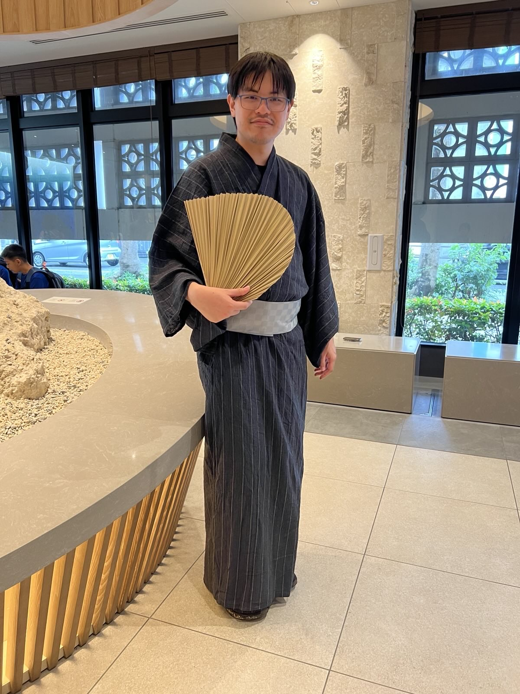

# Hin Chung Henry Tsang

I am a PhD student in Mathematics at the Jeremiah Horrocks Institute, University of Lancashire. Before my current study, I completed my MSc in Mathematics in Uppsala University, Sweden.

The focus of my current research is about cluster algebras using combinatorial techniques. Previously, I have also written about homological algebra in my Master's thesis.

[CV](cv.pdf)

# Link

[CLAN (Clusters and their Applications in the North)](https://clan-clusterstructures.github.io), my supervisor Jon Wilson is the chief of this research group.
